## Leveraging 2D and 3D Vision Foundation Models for Archaeological Artifact Classification {.title-slide}

::: {.eyebrow}
Graphics and Cultural Heritage 2026 · Barcelona · November 2–5
:::

```{=html}
<div class="author-profiles">
  <div class="author-profile">
    
    <div class="author-name">Emery Pierson</div>
    <div class="author-affiliation">LIX · École Polytechnique</div>
  </div>
  <div class="author-profile">
    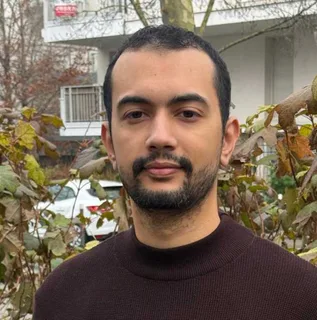
    <div class="author-name">Souhail Hadgi</div>
    <div class="author-affiliation">LIX · École Polytechnique</div>
  </div>
  <div class="author-profile">
    
    <div class="author-name">Diego Gomez</div>
    <div class="author-affiliation">LIX · École Polytechnique</div>
  </div>
  <div class="author-profile">
    
    <div class="author-name">Maks Ovsjanikov</div>
    <div class="author-affiliation">LIX · École Polytechnique</div>
  </div>
  <div class="author-profile">
    
    <div class="author-name">Diego Jiménez-Badillo</div>
    <div class="author-affiliation">INAH · Mexico</div>
  </div>
</div>
```

::: notes
Introduce the collaboration between computer graphics researchers and archaeological expertise. This talk asks whether existing pretrained representations can help organize a small specialist collection.
:::

## Analyzing a cultural heritage dataset. {.dataset-intro}

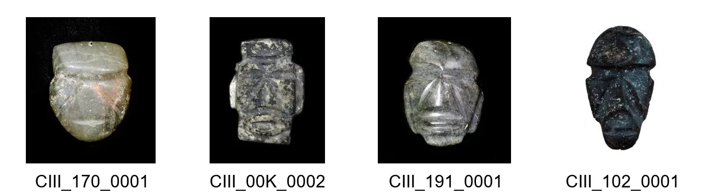{.mask-row fig-alt="Four stone masks from the Mezcala group in the archaeological collection"}


### Challenges

- Typologies depend on subtle morphological differences.
- Label annotations by specialist is difficult.
- Geometry, photographs (and metadata) can capture different evidence.


## Analyzing a cultural heritage dataset. {#dataset-approaches .approach-slide}

::: columns
::: {.column width="50%"}
### Approach 1

Use a **handcrafted geometric descriptor**.

```{=html}
<div class="handcrafted-visual">
  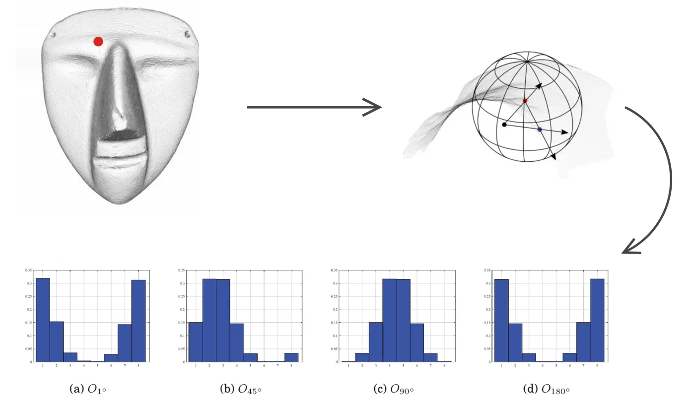
  <div class="descriptor-credit">Román-Rangel et al., JOCCH 2016 · <a href="https://doi.org/10.1145/2948069">Figs. 4(a), 3</a></div>
</div>
```

[[+]{.pro-sign} No training.]{.advantage}

[−]{.con-sign} Limited performance (very generic descriptors).
:::
::: {.column .fragment width="50%" data-fragment-index="0"}
### Approach 2

Learn a **specialized model**.

```{=html}
<div class="specialized-visual">
  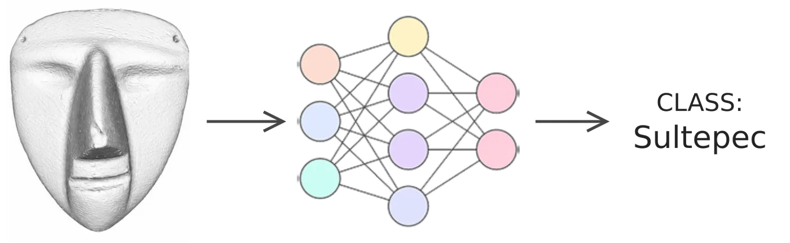
</div>
```

[[+]{.pro-sign} Good performance.]{.advantage}

[−]{.con-sign} Requires training; prone to overfitting.
:::
:::

::: {.fragment .best-worlds-question data-fragment-index="1"}
Can we get the best of both worlds?
:::

## Change of paradigm in ML. {#ml-paradigm .paradigm-slide}

```{=html}
<div class="paradigm-subtitle">From specialized models<span class="paradigm-ellipsis"> ...</span><span class="fragment paradigm-completion" data-fragment-index="0"> to foundation models</span></div>
<div class="paradigm-images">
  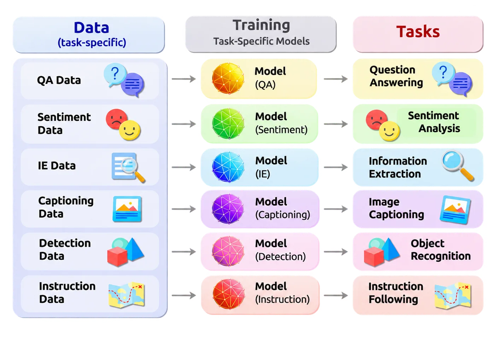
  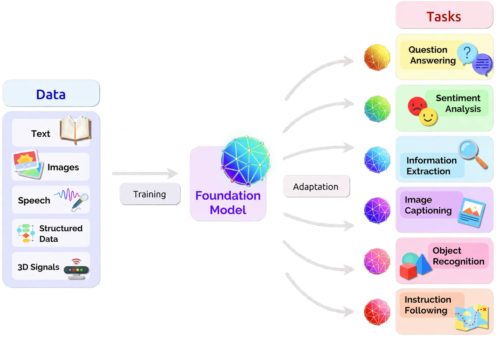
</div>
```

::: {.paradigm-citation}
Bommasani et al., *On the Opportunities and Risks of Foundation Models* (2021). [arXiv:2108.07258](https://arxiv.org/pdf/2108.07258)
:::

## Vision and 3D foundation models. {#vision-3d-models .paradigm-slide .vision-3d-slide}

```{=html}
<div class="paradigm-subtitle">The same paradigm applies to images<span class="paradigm-ellipsis"> ...</span><span class="fragment paradigm-completion" data-fragment-index="0"> and 3D inputs</span></div>
<div class="paradigm-images">
  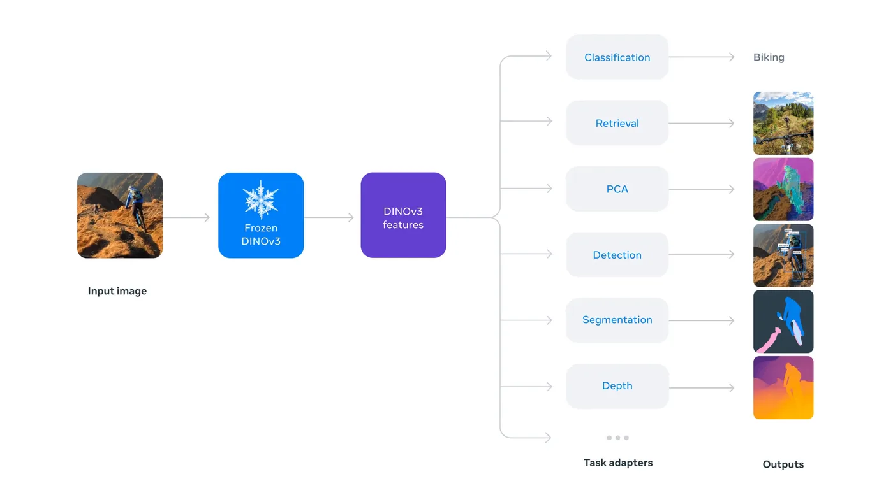
  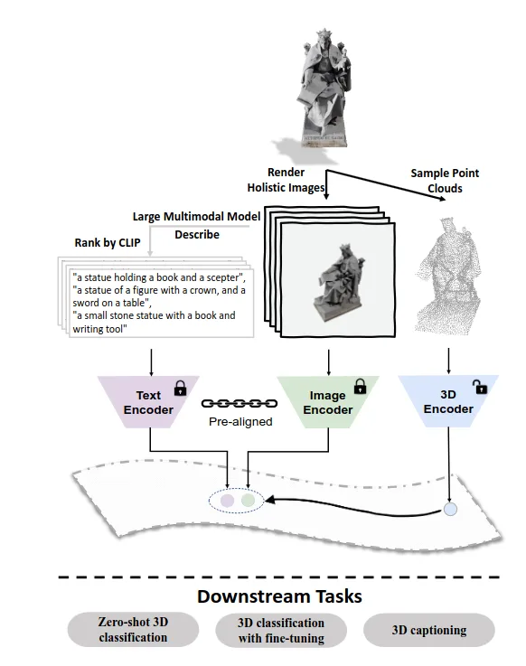
</div>
<div class="paradigm-citation vision-citation">Siméoni et al., <em>DINOv3</em> (2025). <a href="https://arxiv.org/pdf/2508.10104">arXiv:2508.10104</a></div>
<div class="paradigm-citation pointcloud-citation">Xue et al., <em>ULIP-2: Towards Scalable Multimodal Pre-training for 3D Understanding</em>, CVPR 2024. <a href="https://openaccess.thecvf.com/content/CVPR2024/papers/Xue_ULIP-2_Towards_Scalable_Multimodal_Pre-training_for_3D_Understanding_CVPR_2024_paper.pdf">Paper</a></div>
```

::: {.fragment .foundation-question data-fragment-index="1"}
Can vision/3D foundation models bridge the best of both worlds?
:::

## Foundation models for cultural heritage {#heritage-related-work .related-work-slide .visual-related-work}

::: {.related-opening}
Foundation models already find application in cultural heritage
:::

::: columns
::: {.column .related-group .fragment .related-step-0 width="33%" data-fragment-index="0"}
### Segment & document

::: {.related-gallery .single-figure}
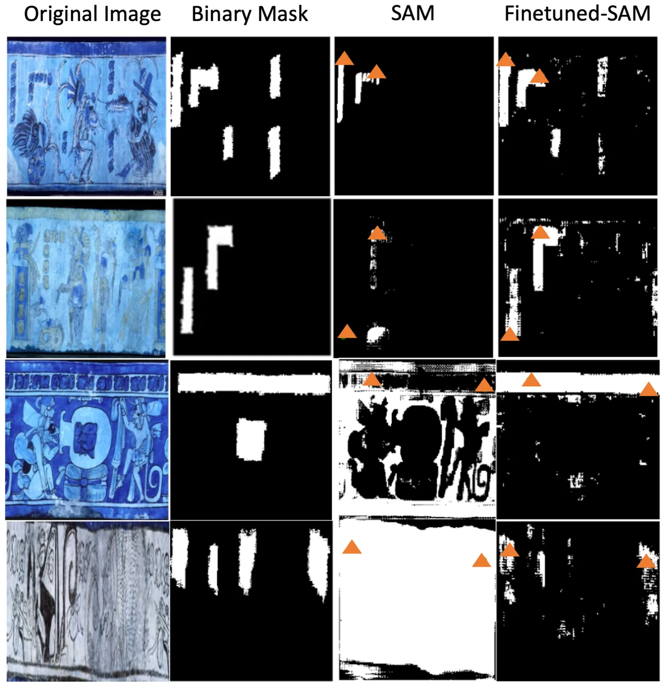{fig-alt="Shivam et al. Figure 3: original Maya vessel images and segmentation by SAM and fine-tuned SAM"}
:::

::: {.related-refs}
[Réby et al., 2023](https://openaccess.thecvf.com/content/ICCV2023W/e-Heritage/papers/Reby_Semantic_Segmentation_Using_Foundation_Models_for_Cultural_Heritage_an_Experimental_ICCVW_2023_paper.pdf) · [Shivam et al., 2024](https://arxiv.org/abs/2405.16426)
:::
:::
::: {.column .related-group .fragment .related-step-1 width="33%" data-fragment-index="1"}
### Retrieve & catalogue

::: {.related-gallery .two-figures}
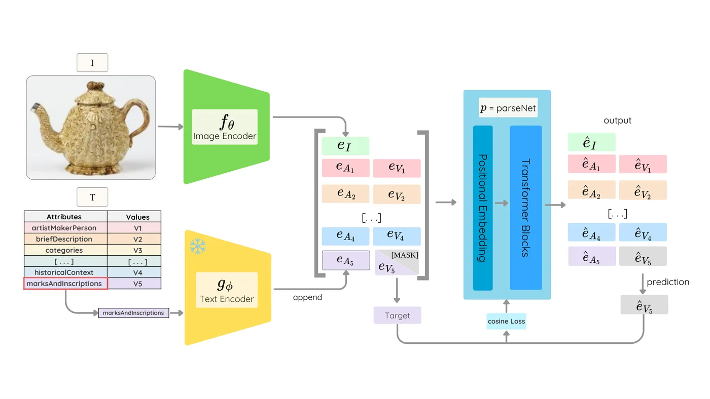{fig-alt="Balauca et al. Figure 5: MUZE image and text encoders with the parseNet attribute prediction network"}

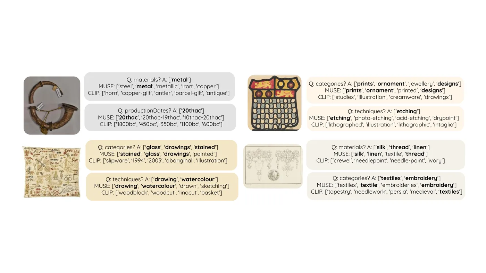{fig-alt="Balauca et al. Figure 1: examples of museum objects and predicted attributes"}
:::

::: {.related-refs}
[Cabral et al., 2024](https://arxiv.org/abs/2412.19091) · [Balauca et al., 2024](https://arxiv.org/abs/2409.01690)
:::
:::
::: {.column .related-group .fragment .related-step-2 width="33%" data-fragment-index="2"}
### Question & reason

::: {.related-gallery .two-figures}
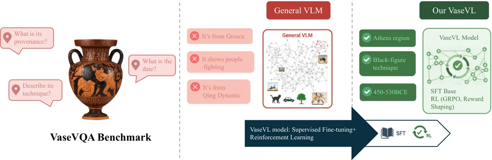{fig-alt="Ge et al. Figure 1: ancient Greek vase questions and the VaseVL framework"}

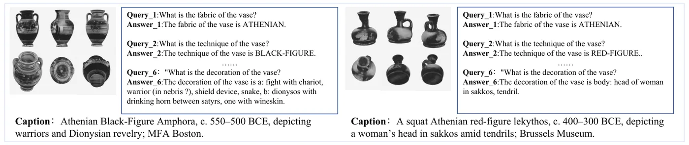{fig-alt="Zhang et al. Figure 2: multiple views of 3D pottery with questions, answers, and captions"}
:::

::: {.related-refs}
[Balauca et al., 2025](https://openaccess.thecvf.com/content/ICCV2025/papers/Balauca_Understanding_Museum_Exhibits_using_Vision-Language_Reasoning_ICCV_2025_paper.pdf) · [Ge et al., 2025](https://arxiv.org/abs/2509.17191) · [Zhang et al., 2025](https://arxiv.org/abs/2510.04479)
:::
:::
:::

::: {.fragment .related-conclusion data-fragment-index="3"}
No systematic evaluation of their performance.

::: {.related-questions}
Can vision/3D foundation models help on specific tasks?
What is the ideal modality for our task?
:::
:::

::: notes
The closing statement refers to the scope of our study: a controlled, comparative evaluation of frozen 2D and 3D encoders for artifact similarity on the same collection. Existing papers do evaluate their own tasks; avoid interpreting this sentence as claiming there are no benchmarks or evaluations in cultural heritage.

These are task-based groups for presenting selected related work, not mutually exclusive categories or an exhaustive survey. Segmentation includes both zero-shot pipelines and domain-specific fine-tuning. Cataloguing and reasoning overlap: MUZE predicts structured attributes, while later museum-exhibit work studies vision-language reasoning. Cabral et al. identify and classify coin features with image and text queries; avoid presenting that work solely as whole-object retrieval. VaseVQA-3D already studies 3D artifacts, so do not claim this work is the first application of foundation models to 3D cultural heritage. Our distinguishing focus is a controlled comparison of frozen 2D/3D representations on the same mask collection.
:::

## Presentation of the dataset. {#dataset-presentation .dataset-presentation}

::: {.dataset-context}
Carved stone masks recovered from **14 Mexica (Aztec) offerings at the Templo Mayor** (1390–1469 CE), documented through **3D laser scans and photographs**.

**Goal:** Help identify masks that experts cannot reliably label.
:::

::: columns
::: {.column width="48%"}
::: {.dataset-count}
**110 masks** · Museo del Templo Mayor, Mexico City
:::

- **84 confidently annotated** masks used for evaluation
- **26 masks without reliable expert labels** — the target for subsequent identification
- Evaluate on the labeled subset before exploring the uncertain masks.

:::
::: {.column width="52%"}
### Four expert-defined stylistic traditions

```{=html}
<div class="dataset-examples">
  <figure>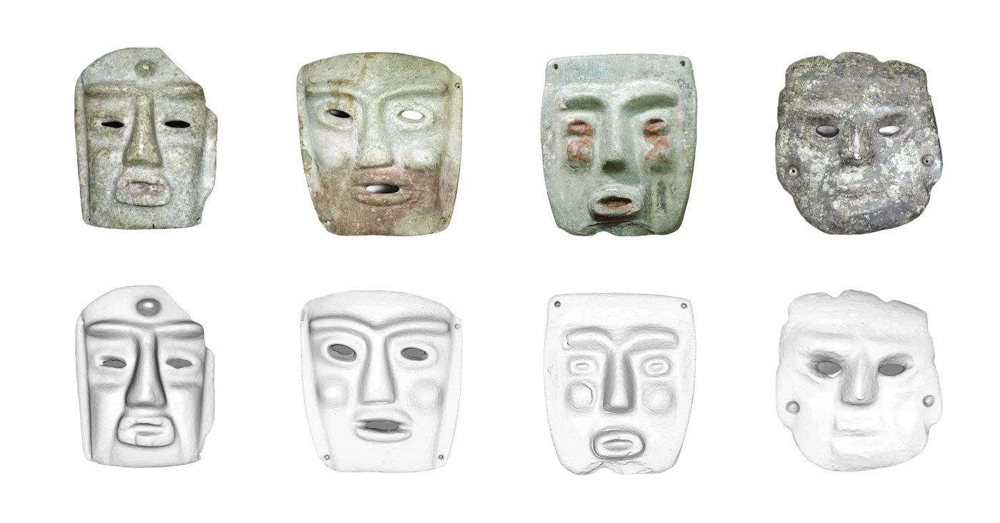<figcaption>Chontal</figcaption></figure>
  <figure>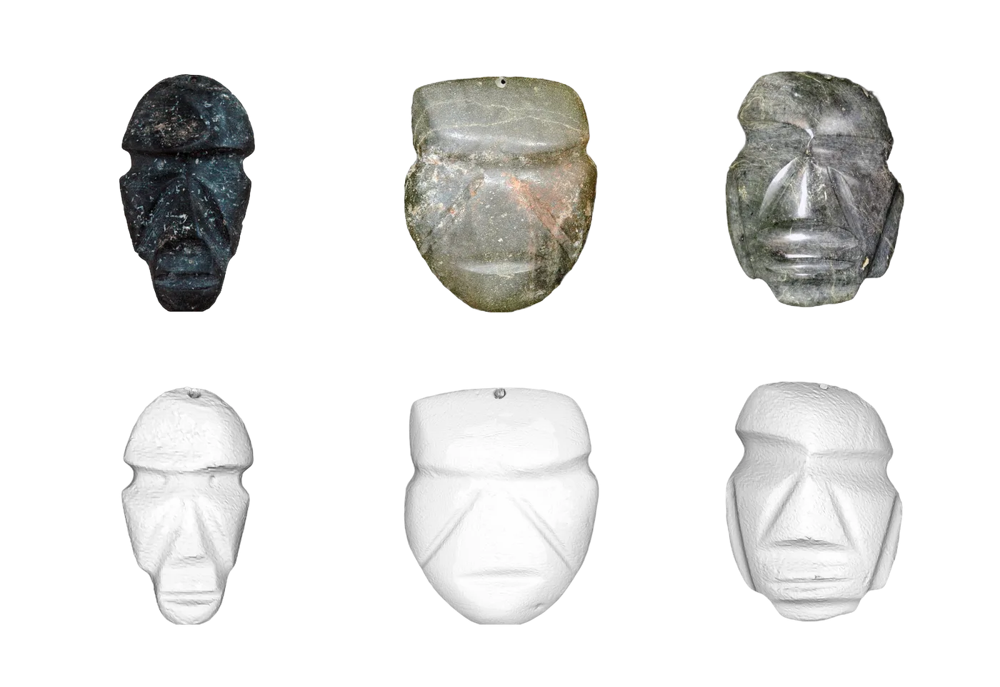<figcaption>Mezcala</figcaption></figure>
  <figure>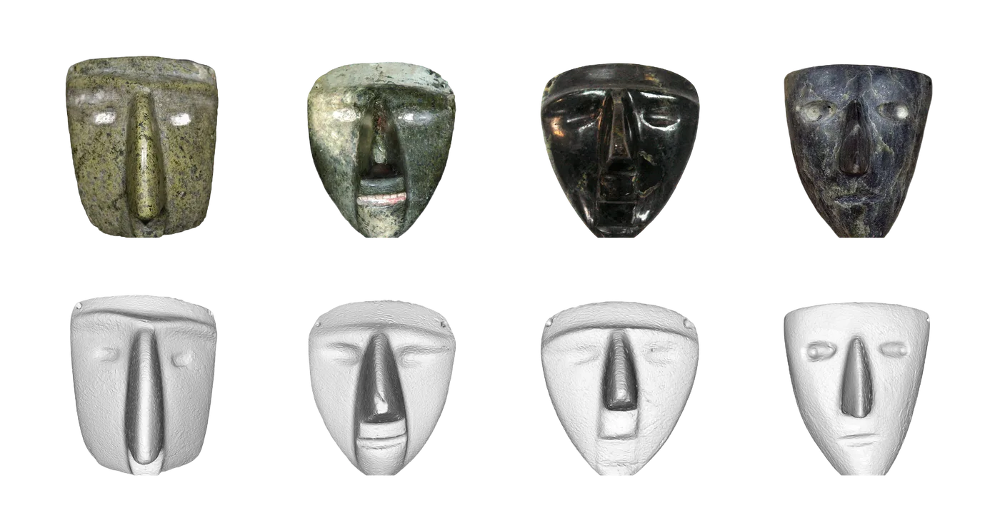<figcaption>Sultepec</figcaption></figure>
  <figure>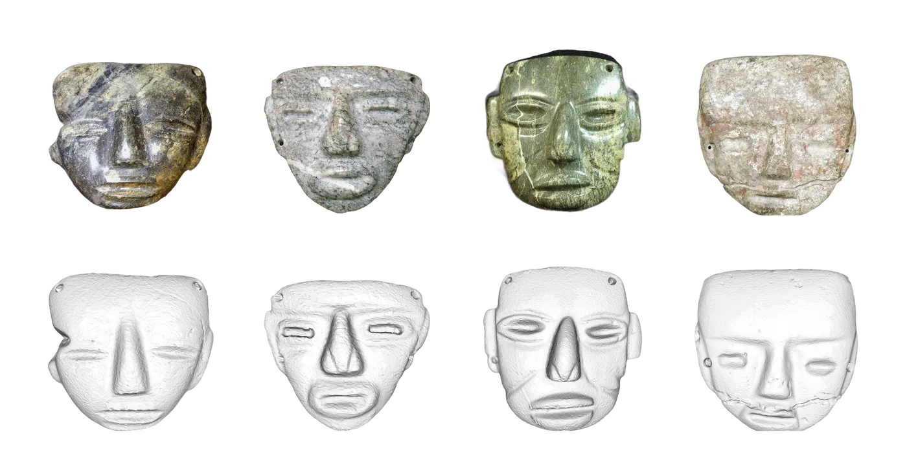<figcaption>Teotihuacanoid</figcaption></figure>
</div>
```

::: {.small}
Photographs and corresponding 3D renderings. Evaluation uses the four main traditions.
:::
:::
:::

::: notes
The objective is to support identification of masks with uncertain expert labels. The current quantitative benchmark evaluates only the 84 confidently annotated masks; no identification accuracy is claimed for the 26 uncertain masks.

Historical context follows the manuscript's dataset section. Offering dates refer to archaeological deposition, not securely established production dates of the masks. Stylistic affinity does not establish provenance. The manuscript discusses both relic collection and possible Aztec-period production. Annotations are expert-defined stylistic categories; class sizes are imbalanced.
:::

## Chontal style {#style-chontal .style-detail}

::: {.style-description}
Relatively naturalistic facial proportions, with sharp ridges and rectangular or trapezoidal outlines. A **T-shaped brow–nose ridge** and frequently perforated eyes and mouths are characteristic.
:::

::: {.style-history}
Associated with the stone-carving traditions of **Guerrero, southwestern Mexico**. Masks in this collection were deposited in Mexica offerings at the Templo Mayor, far from that region.
:::

::: {.style-stats}
51 masks · 5 substyles within the Guerrero stone-carving tradition.
:::

{.style-gallery fig-alt="Representative chontal masks reproduced from the paper, with photographs above corresponding 3D renderings"}

::: notes
Representative figure reproduced from figures/classes in the manuscript; no individual substyles are labeled on the slide. Photographs appear above the corresponding geometric renderings. The substyle count records the dataset taxonomy within a shared regional/stylistic tradition; it does not establish identical production dates. Historical context and morphology follow final/intro.tex. Offering dates are deposition dates; the masks' production dates and origins remain debated.
Additional cultural context: https://museoamparo.com/colecciones/pieza/4452/mascara-antropomorfa-de-rostro-globoso-estilo-chontal
:::

## Mezcala style {#style-mezcala .style-detail}

::: {.style-description}
Strong **geometric abstraction**: facial features are reduced to planes, grooves, and sharp divisions. Narrow temples, broad jaws, and schematic square ears are characteristic.
:::

::: {.style-history}
Linked to the **Balsas River region of Guerrero**. Mezcala-style objects remained valued in Late Postclassic offerings at the Templo Mayor, after the flourishing of earlier regional traditions.
:::

::: {.style-stats}
8 masks · 2 substyles within the Mezcala regional tradition.
:::

{.style-gallery fig-alt="Representative mezcala masks reproduced from the paper, with photographs above corresponding 3D renderings"}

::: notes
Representative figure reproduced from figures/classes in the manuscript; no individual substyles are labeled on the slide. Photographs appear above the corresponding geometric renderings. The substyle count records the dataset taxonomy within a shared regional/stylistic tradition; it does not establish identical production dates. Historical context and morphology follow final/intro.tex. Offering dates are deposition dates; the masks' production dates and origins remain debated.
Additional cultural context: https://www.metmuseum.org/art/collection/search/314592
:::

## Sultepec style {#style-sultepec .style-detail}

::: {.style-description}
Flat, slightly triangular faces are dominated by an exaggerated **hook-shaped, pointed nose**. Carved eyes are absent; a simple ridge marks the brow.
:::

::: {.style-history}
A localized group within the **Guerrero-related stone-mask traditions** discussed in the paper. These examples were recovered from Mexica offerings, whose dates do not necessarily establish when the masks were carved.
:::

::: {.style-stats}
6 masks · One stylistic group within the Guerrero-related traditions.
:::

{.style-gallery fig-alt="Representative sultepec masks reproduced from the paper, with photographs above corresponding 3D renderings"}

::: notes
Representative figure reproduced from figures/classes in the manuscript; no individual substyles are labeled on the slide. Photographs appear above the corresponding geometric renderings. The substyle count records the dataset taxonomy within a shared regional/stylistic tradition; it does not establish identical production dates. Historical context and morphology follow final/intro.tex. Offering dates are deposition dates; the masks' production dates and origins remain debated.
:::

## Teotihuacanoid style {#style-teotihuacanoid .style-detail}

::: {.style-description}
**Elongated eyes with defined eyelids** and open or partly open mouths with modeled lips echo Teotihuacan artistic conventions. The label describes stylistic affinity, rather than a secure origin or production date.
:::

::: {.style-history}
The style recalls **Teotihuacan**, a major urban center of Classic-period central Mexico. Its presence in later Mexica offerings reflects the circulation or reinterpretation of earlier artistic traditions.
:::

::: {.style-stats}
19 masks · 2 substyles sharing a Teotihuacan-inspired visual tradition.
:::

{.style-gallery fig-alt="Representative teotihuacanoid masks reproduced from the paper, with photographs above corresponding 3D renderings"}

::: notes
Representative figure reproduced from figures/classes in the manuscript; no individual substyles are labeled on the slide. Photographs appear above the corresponding geometric renderings. The substyle count records the dataset taxonomy within a shared regional/stylistic tradition; it does not establish identical production dates. Historical context and morphology follow final/intro.tex. Offering dates are deposition dates; the masks' production dates and origins remain debated.
:::

## Foundation models {#evaluated-foundation-models .model-list-slide}

::: columns
::: {.column width="50%"}
### 3D

::: {.model-entry}
**Point-BERT** · [Yu et al., 2022](https://arxiv.org/abs/2111.14819)

Self-supervised: predict masked point-patch tokens on ShapeNet.
:::

::: {.model-entry}
**Point-MAE** · [Pang et al., 2022](https://arxiv.org/abs/2203.06604)

Self-supervised: reconstruct masked point patches on ShapeNet.
:::

::: {.model-entry}
**Uni3D** · [Zhou et al., 2024](https://openreview.net/forum?id=wcaE4Dfgt8)

Align point-cloud features with pretrained image–text representations at scale.
:::
:::
::: {.column width="50%"}
### Vision

::: {.model-entry}
**ViT** · [Dosovitskiy et al., 2021](https://openreview.net/forum?id=YicbFdNTTy)

Supervised image classification; ImageNet-pretrained weights in our study.
:::

::: {.model-entry}
**CLIP** · [Radford et al., 2021](https://arxiv.org/abs/2103.00020)

Contrastive image–text alignment on 400M image–caption pairs.
:::

::: {.model-entry}
**DINOv2** · [Oquab et al., 2023](https://arxiv.org/abs/2304.07193)

Self-supervised image and patch features on curated images; no text labels.
:::

::: {.model-entry}
**DINOv3** · [Siméoni et al., 2025](https://arxiv.org/abs/2508.10104)

Large-scale self-supervised learning; Gram anchoring preserves dense features.
:::
:::
:::

::: takeaway
All encoders are **frozen** in our study: no training or fine-tuning on the masks.
:::

::: notes
This slide lists the encoders evaluated in the manuscript, rather than all models introduced in the background slides: ULIP-2 illustrates 3D pretraining but is not in the reported benchmark. ViT is an architecture; its training description refers to the supervised pretrained checkpoint used here. Point-BERT predicts discrete tokens learned by a tokenizer, while Point-MAE reconstructs geometry directly. Uni3D uses image-text-aligned representations as training targets. Dates follow the original publications or conference years: Point-MAE ECCV 2022; Uni3D ICLR 2024.
:::

## Inputs {#artifact-inputs .inputs-slide}

```{=html}
<div class="input-artifact">
  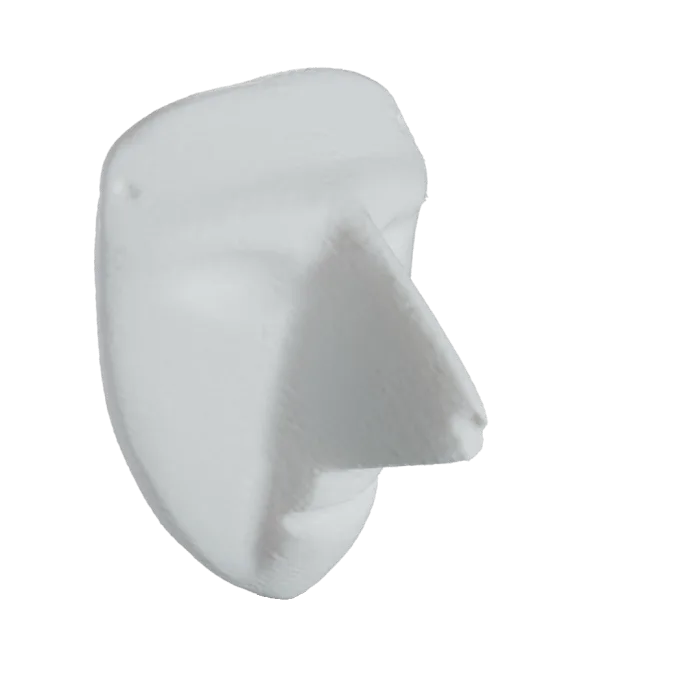
  <div>3D artifact</div>
</div>
<svg class="input-arrows" viewBox="0 0 1488 95" preserveAspectRatio="none" aria-hidden="true">
  <defs><marker id="input-arrowhead" viewBox="0 0 10 10" refX="9" refY="5" markerWidth="7" markerHeight="7" orient="auto"><path d="M1 1 L9 5 L1 9" fill="none" stroke="#666" stroke-width="1.5"/></marker></defs>
  <g fill="none" stroke="#666" stroke-width="2" marker-end="url(#input-arrowhead)">
    <path d="M744 3 L178 88"/>
    <path d="M744 3 L565 88"/>
    <path d="M744 3 L923 88"/>
    <path d="M744 3 L1310 88"/>
  </g>
</svg>
<div class="input-representations">
  <figure class="input-photo">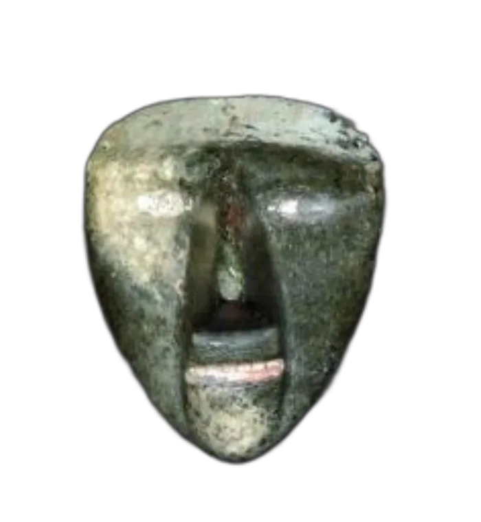<figcaption>Photograph</figcaption></figure>
  <div class="input-renderings">
    <div class="input-rendering-pair">
      <figure>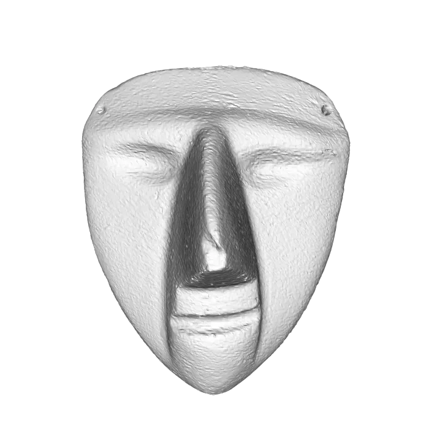<figcaption>Grey rendering</figcaption></figure>
      <figure class="input-normal">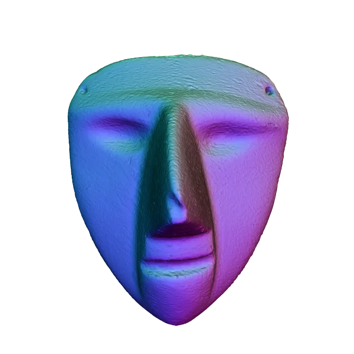<figcaption>Normal rendering</figcaption></figure>
    </div>
  </div>
  <figure class="input-pointcloud">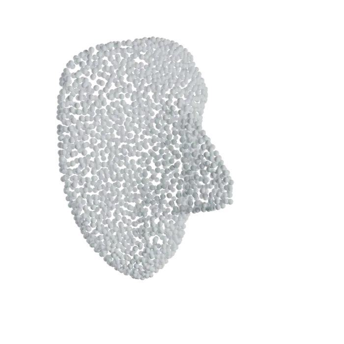<figcaption>Point cloud</figcaption></figure>
</div>
```

::: notes
Artifact, photograph, grey rendering, and point-cloud images are extracted from figures/overview.pdf, preserving the original PDF soft masks. The upper artifact image box is 250px, 25% larger than the 200px input examples. Normal rendering supplied in ~/CII_105_0001/render_normal.png, with the matching 1800×1800 grey-rendering silhouette soft mask applied for background consistency. Normal colors are preserved.
:::

## Full approach

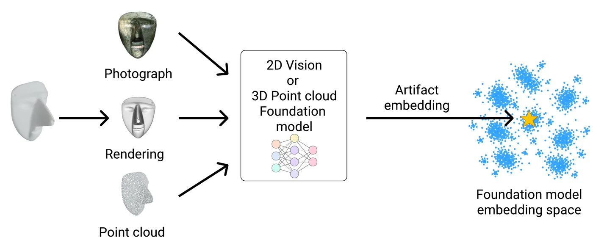{width=95% fig-alt="Paper overview of foundation models applied to artifact representations"}


::: notes
No model is fine-tuned on the masks. Expert labels are used to evaluate the representations, rather than train the encoders.
:::

## Evaluation {#evaluation .evaluation-slide}

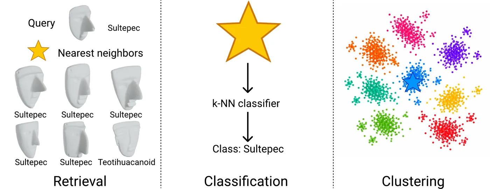{.evaluation-image fig-alt="Retrieval, nearest-neighbor classification, and clustering evaluation tasks"}


## Frozen models improve nearest-neighbor retrieval {.retrieval-results}

| Model | Input | NN accuracy |
|:--|:--|--:|
| SPH - baseline | Mesh | 54.8% |
| Point-MAE | Point cloud | 59.5% |
| Point-BERT | Point cloud | 66.7% |
| Uni3D large | Point cloud | 84.5% |
| DINOv3 | Normal, front view | 89.3% |
| **CLIP** | **Grey, front view** | **90.5%** |

::: {.retrieval-summary}
Across **all 29 configurations**: mean **80.1%** (+25.3 pp); median **82.1%** (+27.3 pp) vs SPH.

Best result in both modalities uses **semantic supervision**: CLIP (vision, image–text alignment) and Uni3D (3D, image–text-aligned targets).

CLIP improves over SPH by **35.7 percentage points**.
:::

::: notes
Mean and median are calculated over all 29 active foundation-model rows in tables/table_merged.tex, excluding SPH, the random baseline, and commented-out rows. Each model/input configuration has equal weight. Mean NN = 0.8013103448; median NN = 0.821. Gains relative to SPH NN = 0.548 are 25.331 and 27.3 percentage points. Displayed values are rounded to one decimal.

Semantic supervision is a descriptive comparison of the best observed configurations within each modality: CLIP grey front-view NN = 0.905, exceeding DINOv3 best = 0.893; Uni3D large NN = 0.845, exceeding Point-BERT = 0.667 and Point-MAE = 0.595. This is not a universal ranking across inputs: DINOv3 has a higher mean across the six vision inputs than CLIP. It also does not isolate the causal effect of supervision from training scale or other differences.

NN = same-class top-ranked neighbor. Use the active merged table as the numerical source. The abstract/discussion quote a different SPH baseline near 58%; resolve that source inconsistency before publication. No statistical significance claim is made.
:::

## Geometric cues outweigh texture cues {#geometric-cues .geometry-results}

Average NN retrieval improvement across **CLIP, DINOv2, DINOv3, and ViT-Large**.

::: columns
::: {.column width="50%" .panel}
**High-resolution photograph → Normal rendering**

::: {.geometry-gain}
+8.0 pp
:::

Mean NN accuracy: **76.5% → 84.5%**
:::
::: {.column width="50%" .panel}
**High-resolution photograph → Grey rendering**

::: {.geometry-gain}
+7.4 pp
:::

Mean NN accuracy: **76.5% → 83.9%**
:::
:::

::: takeaway
For stylistic similarity in this collection, **geometric cues are more important than texture cues**.
:::

::: {.small}
Matched comparisons within each encoder; single front-view renderings. Gains in percentage points.
:::

::: notes
Calculated from the four vision-model families in the active tables/table_merged.tex. Each model is weighted equally, comparing High-res. photo with Normal, front view or Grey, front view. Multi-view rows are excluded from this matched single-view comparison.

High-res. photo NN values: CLIP .738, DINOv2 .667, DINOv3 .845, ViT-Large .810; mean .765. Normal front: .857, .833, .893, .798; mean .84525; mean improvement .08025 = 8.025 percentage points. Grey front: .905, .762, .857, .833; mean .83925; mean improvement .07425 = 7.425 points. Display rounded to one decimal.

This is an average tendency on this collection. ViT-Large normal-front is 1.2 points below its high-resolution photograph result; all four grey-front results improve. The input comparison supports the importance of morphology but does not isolate texture causally from lighting, background, or acquisition differences.
:::

## Robustness to class imbalance {#class-imbalance .confusion-slide}

::: {.confusion-context}
**Chontal: 51** · Mezcala: 8 · Sultepec: 6 · Teotihuacanoid: 19
:::

::: {.confusion-grid}
::: {.confusion-panel}
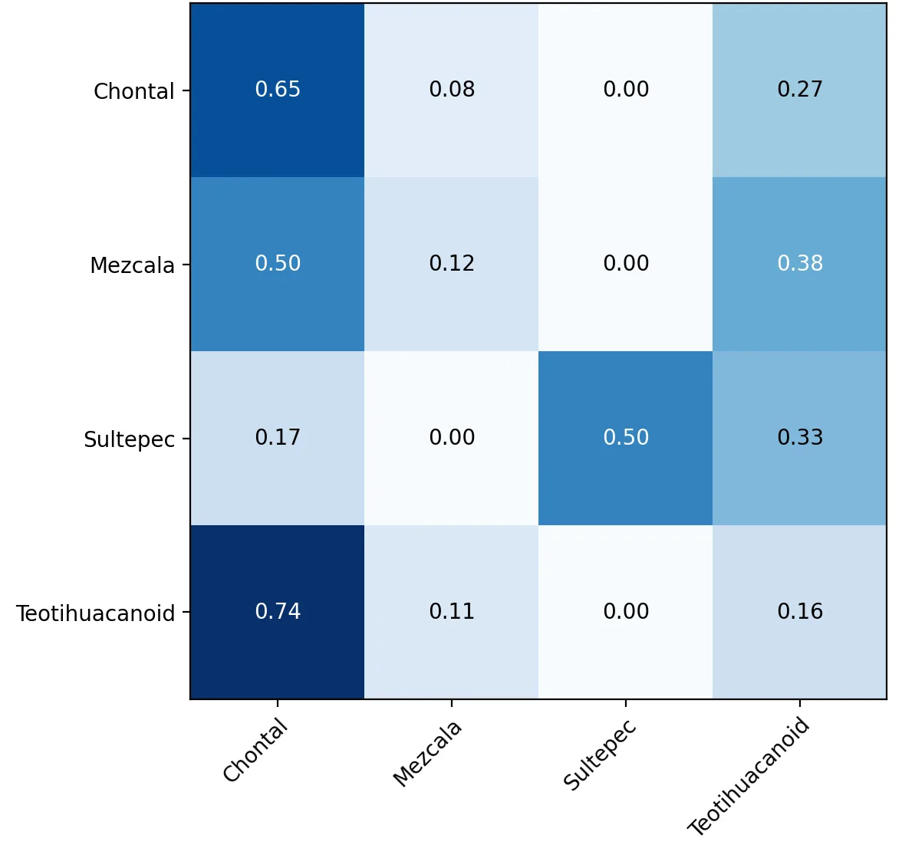{fig-alt="SPH baseline row-normalized confusion matrix"}

::: {.matrix-name}
SPH — baseline
:::
::: {.matrix-input}
Mesh
:::

:::
::: {.confusion-panel}
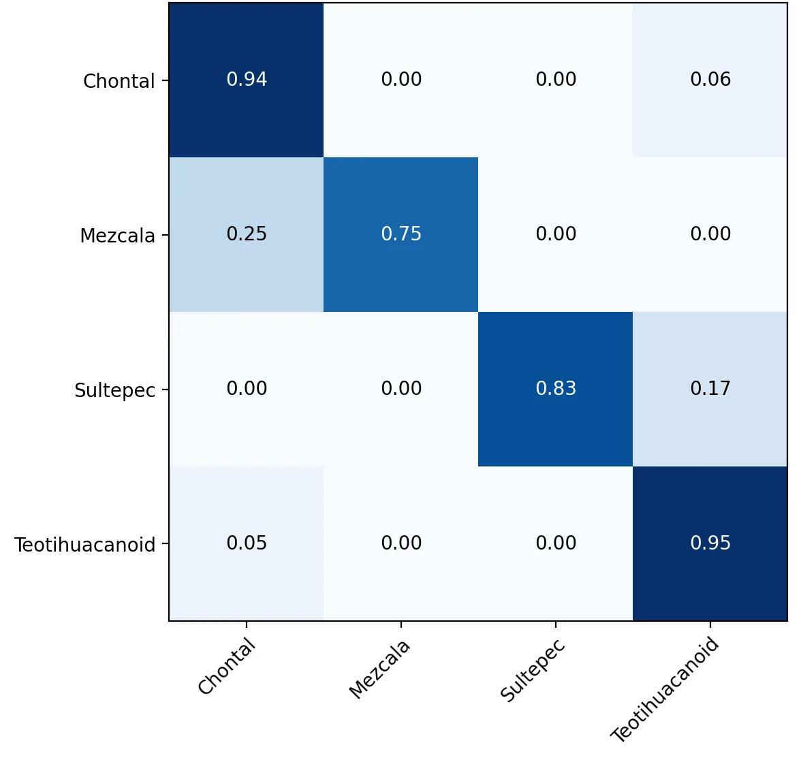{fig-alt="CLIP with front-view grey rendering: row-normalized confusion matrix"}

::: {.matrix-name}
CLIP
:::
::: {.matrix-input}
Grey front rendering
:::

:::
::: {.confusion-panel}
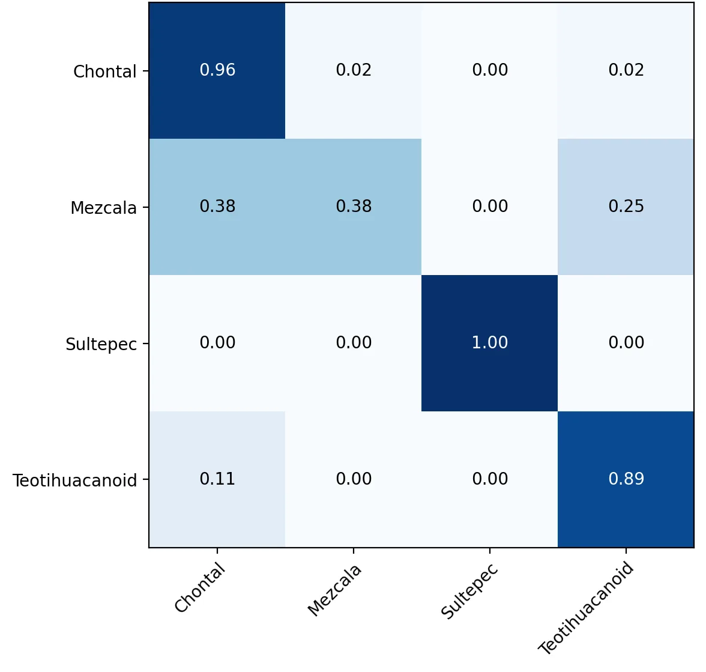{fig-alt="DINOv3 giant with multiview grey renderings: row-normalized confusion matrix"}

::: {.matrix-name}
DINOv3 giant
:::
::: {.matrix-input}
Multi-view grey renderings
:::

:::
:::

::: {.small}
Rows: true style · Columns: predicted style · Each row normalized to 1.
:::

::: takeaway
Foundation models improve recall for the smaller classes.
:::

::: notes
The matrices are existing figures from figures/confusion: SPH__Mesh__train.png, clip_vit_large_patch14__render_grey__train.png, and hf_dinov3_giant__multiview_grey__train.png. DINOv3 is explicitly the giant multiview-grey configuration, rather than the normal-front configuration shown on the earlier results slide.

Read each diagonal entry as class recall. The row normalization prevents the majority class from dominating the visual comparison. SPH recalls for Mezcala/Sultepec/Teotihuacanoid are approximately .12/.50/.16; CLIP .75/.83/.95; DINOv3 giant .38/1.00/.89. Small classes have few examples, so a single prediction changes recall substantially. These figures show performance on the observed class imbalance, not a controlled experiment varying class proportions. The saved SPH confusion matrix and the manuscript summary table may originate from different result versions; do not derive or equate overall accuracy across those artifacts without checking experiment provenance.
:::

## Clustering improves, but remains difficult {#clustering-results .clustering-results}

::: {.clustering-content}

::: {.clustering-summary}
| Across all configurations | Mean | Median | Average gain over SPH |
|:--|--:|--:|--:|
| Adjusted Rand index | 0.102 | 0.091 | **+0.108** |
| Normalized mutual information | 0.223 | 0.215 | **+0.149** |
:::

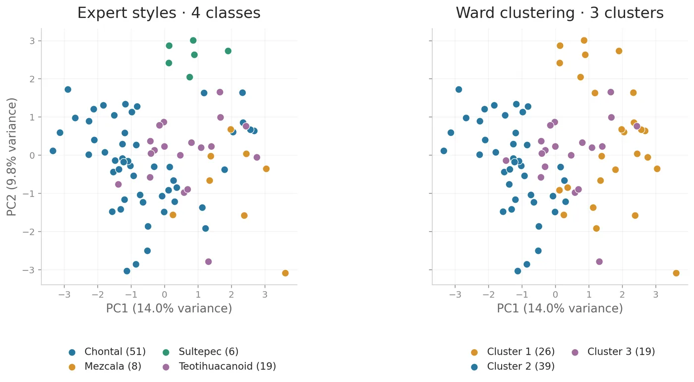{.clustering-pca fig-alt="Identical PCA coordinates colored by four expert styles on the left and the three recovered Ward clusters on the right"}

::: {.clustering-caption}
Best reported ARI: **DINOv3 giant · normal renderings · Ward · ARI 0.491**. Same PCA coordinates; clustering uses the full embeddings.
:::

::: {.fragment .clustering-takeaway-overlay}
::: {.takeaway .clustering-takeaway-card}
**Better clustering overall,
but agreement remains low.**

Class imbalance can hinder clustering, especially K-means: large classes may split while small classes merge.
:::
:::

:::

::: notes
Aggregate: 29 foundation-model/input configurations × 3 clustering methods = 87 results from tables/table_clustering.tex. Mean and median pool all 87 entries. Gains are paired differences from SPH under the same clustering algorithm, then averaged; absolute index differences, not relative percentages. Values are rounded to three decimals in the manuscript table.

Reproduced on Vega from projects/masks_clustering, metrics/clustering.py agglomerative_clustering, using embeddings/img_type_render_normal/model_hf_dinov3_giant/embeddings_train.npy and its label sidecar. Best reported ARI is 0.4907931707065586, NMI 0.5236846143255619, with Ward linkage, 3 clusters, no PCA preprocessing. The 2D PCA is fitted once solely for visualization; coordinates and axis limits are identical in both panels. Cluster numbers and colors have no semantic correspondence to expert labels.

Expert class sizes: Chontal 51, Mezcala 8, Sultepec 6, Teotihuacanoid 19. Contingency by those rows and cluster columns 1–3: [11,38,2], [8,0,0], [6,0,0], [1,1,17]. This best configuration merges the two smallest styles and splits Chontal. Class imbalance is a plausible contributor, not established as the sole cause by these experiments. K-means minimizes squared distances and favors compact groups; it does not explicitly impose equal cluster sizes. The illustrated best configuration is Ward, not K-means.

Reproduction script: quarto/scripts/plot-clustering-pca.py; outputs and per-sample provenance: quarto/images/clustering/.
:::

## What regions attract the model’s attention? {#model-attention .attention-slide}

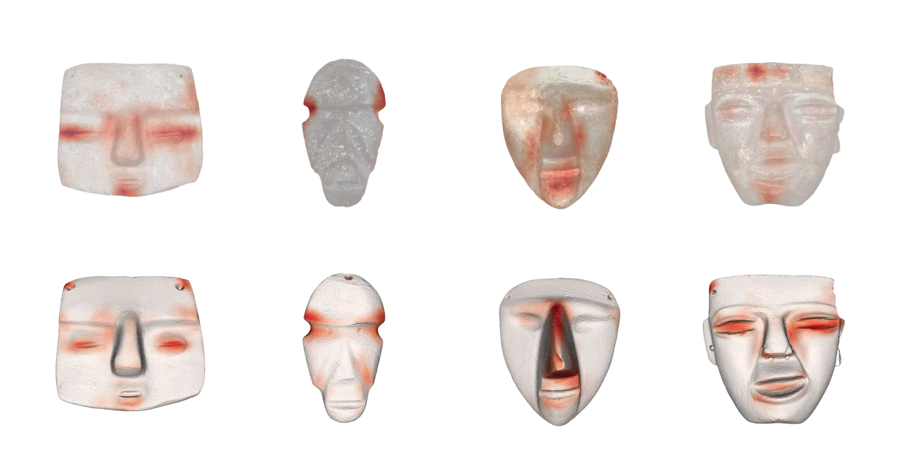{height=470 fig-alt="DINOv2 attention maps on photographs and renderings of four mask styles"}

DINOv2 emphasizes facial structures such as **eyes, noses, and mouths**.

::: small
Attention maps offer qualitative evidence, rather than a causal explanation of the predictions.
:::

## Takeaways, limitations and future work {#takeaways-limitations .takeaways-limitations}

### Takeaways

::: {.incremental}

- **Frozen foundation models transfer** to this specialist mask collection.
- **Rendered geometry is highly informative, and semantic is key:** CLIP reaches 90.5% NN retrieval.
- **Similarity search is promising; unsupervised grouping is harder.**
- **A practical tool for heritage:** support cataloguing and expert comparison with little task-specific training data.

:::

### Limitations and future work

::: {.incremental}

- **Small, imbalanced collection:** evaluate on broader collections and varied acquisition conditions.
- **Low clustering agreement:** explore methods that better handle unequal class sizes.
- **Limited archaeological context:** integrate text and contextual metadata, and validate with heritage experts.

:::

## Thank you {#thank-you .closing-slide}

::: {.subtitle}
Can these representations help explore your collection?
:::

::: {.closing-links}
::: {.closing-link}
{fig-alt="QR code linking to the foundation_archeo GitHub repository"}

**Code**

[github.com/daidedou/foundation_archeo](https://github.com/daidedou/foundation_archeo)
:::
::: {.closing-link}
{fig-alt="QR code linking to the project and dataset information"}

**Project and dataset**

[daidedou.sorpi.fr/publication/foundation_artifact](https://daidedou.sorpi.fr/publication/foundation_artifact)
:::
:::

